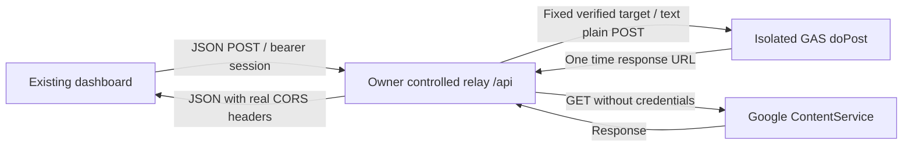

# V2 browser transport

## Evidence and limits

The owner browser trace recorded a GAS `/macros/s/<deployment>/exec` HTTP 200 JSON response with an actual `Access-Control-Allow-Origin: *` header. A subsequent **GET** to Google's ContentService response host returned HTTP **400**, `text/html`, **without** that header. Chrome reported `MissingAllowOriginHeader` and `net::ERR_FAILED`. Login had not run. These are HTTP/CDP observations, not a JSON `allowOrigin` field.

The missing CORS header explains why JavaScript could not read that error response. It does **not** establish why Google returned 400. The supplied evidence does not establish a bad deployment permission, bad password, OPTIONS failure, or a malformed signed URL. No known-good source, NH gateway, or AccountStore was changed to speculate about those causes. Retrying the same direct browser check is unnecessary.

ContentService officially redirects clients to a one-time `script.googleusercontent.com` response URL. TextOutput does not provide arbitrary CORS response headers. Adding fictitious header setters, `no-cors`, JSONP, disabling Chrome security, or a public CORS proxy is not a solution.

The previous browser harness used Playwright request routing. Playwright may internally fulfill preflight OPTIONS when routing is installed; its `preflightObserved: false` is therefore **not proof that Chrome required no preflight**. The new relay browser checks use **no page/context request routing**. They exercise real local HTTP, OPTIONS, response headers and Chrome's normal CORS enforcement. Their upstream GAS responses remain synthetic unless explicitly run by the owner against isolated GAS.

## Options

| Criterion | A: direct fetch to GAS | B: GAS HTML Service / google.script.run | C: owner-controlled fixed relay | D: iframe bridge / other |
|---|---|---|---|---|
| Keep GitHub Pages | Yes | Full hosting changes, or a second embedded application | Yes | Possible; two origins/protocols remain |
| Browser CORS / redirects | Depends on Google Content response; observed failure unresolved | Avoids ContentService browser fetch for RPC | Real CORS owned by relay; Google redirects handled server-side | Requires origin/source/nonce validation; more moving parts |
| Credentials | POST body to GAS | RPC to GAS; callable export audit needed | POST to trusted relay, then fixed verified GAS; no redirect credential replay | Additional message boundary to audit |
| Session authority | Existing GAS | Existing GAS with adapter | Existing GAS unchanged | Depends on implementation |
| Read-only NH boundary | Existing gateway | Preserve gateway, audit public RPC functions first | Existing gateway unchanged; current validation profile blocks all NH | Additional allowlist needed |
| Cost | GAS quotas | GAS quotas | Local validation costs no new service; public hosting may cost money | Usually GAS quotas plus maintenance |
| PC / Fold6 | Standard browser, observed transport failure | Responsive app possible, hosting transition | Standard fetch/CORS; responsive UI retained | Responsive integration needs extra tests |
| Maintenance / expansion | Few components but unresolved dependency | UI packaging and public export changes | One small server and one shared client adapter; explicit deployment required | More protocol and session complexity |

**Selected development candidate: C.** It preserves Pages, the UI, GAS login/session authorization, NH Read-Only Gateway V2, and AccountStoreV2. Full HTML Service hosting is possible, but is not a drop-in transport replacement: `google.script.run` exposes non-private server functions, and the current project contains editor diagnostic exports. That option needs its own export/security review and a hosting change. It is not enabled here.

## Boundary and behavior

- Relay `/api` accepts an exact configured Origin, POST JSON, limited body size, a fixed action list and no URL query. OPTIONS returns real HTTP headers. Origin checking is CORS/CSRF policy, **not user authentication**. GAS remains the session/admin authority.
- A session is carried in the browser's Authorization header and forwarded in the POST body only to the single configured GAS deployment. Passwords remain in login POST bodies. No password/token is in a URL or forwarded to a redirect target. No request, response body, signed content URL, or financial data is logged.
- Before login forwarding, metadata must match the isolated project/sheet fingerprints, source digest, gateway version and store engine. A production target is rejected by the isolated profile. The owner helper separately reads **actual deployment API metadata**, checks version, owner execution and anonymous reachability; it does not infer these from `appsscript.json`.
- Only HTTPS Google ContentService `/macros/echo` 301/302/303 destinations are followed, as fresh GET requests without the password/token body or Authorization. Signed query bytes are preserved. Google login redirects, other hosts, and 307/308 body replay are rejected. These GAS response redirects are separate from **NH API redirects**, which remain disabled in the unchanged gateway.
- No retry, backend fallback or blind mutation replay occurs. If a write response is lost, report `RELAY_WRITE_OUTCOME_UNKNOWN`; reread/reconcile the existing revision before deciding whether to resubmit. A duplicate that reaches GAS still uses the existing revision guard.
- Public market/news reads use the same transport, with an authenticated session and fixed public HTTPS host allowlist; NH/private hosts are excluded. The optional full profile preserves existing account and manual/OCR interfaces. It is exercised only with synthetic data in this change.
- Browser relay fetch uses `credentials: omit`, `redirect: error`, `cache: no-store`. A relay failure never falls back to direct GAS or a production address. An explicitly configured relay with a missing/invalid transport module fails closed. Existing direct mode stays the default for compatibility until an approved endpoint is configured; this does **not** claim the old direct browser issue is fixed.
- Response size is bounded at 50 MiB to retain the existing Drive-image/OCR interface. Public hosting requires appropriate memory/concurrency/timeout limits. The current validation profile does not permit images or account data at all.

## Owner-only actual GAS check

`tools/nh_v2_relay_check.py --environment <existing-private-environment>` reuses the existing private fresh plan, source verification, metadata, and Google credentials. It does not create infrastructure, deploy GAS, capture/restore snapshots, migrate data or make NH calls. Only four upstream actions are allowed: `appVersion`, `login`, `sessionInfo`, `logout`. Background UI attempts to load accounts are blocked by the relay **before GAS**. Authentication necessarily creates/revokes test login sessions using the existing GAS mechanism; no account-store or production writes are performed.

The tool starts two loopback processes inside the owner's existing Cloud Shell (dashboard and relay), then runs Chrome with normal security, real cross-origin HTTP and no Playwright routing. Local CSP blocks third-party services and direct browser GAS requests. Enter the dashboard username at its visible prompt and password at its hidden prompt, only in that private terminal. Google permission or deployment metadata failures stop before credentials are sent. The test checks unauthenticated denial, metadata, login, reload, five real minutes of inactivity, and rejection of the expired/revoked session. No financial-data rendering or NH success is claimed by this auth-only test. Only fixed status/codes are printed.

Dependencies are the existing Python environment and Playwright/Chromium already used by the owner's validation tools. No new package/service/account is needed for this loopback check. Do not run older full-flow or snapshot helpers as part of this auth-only task.

## Public-hosting candidate, not a deployment

`relay/app.py` is a small stdlib WSGI service. `relay/wsgi.py`, the pinned Gunicorn requirement and `relay/Dockerfile` are deployment candidates, not automatically executed workflows. They have **not** created a cloud service, billing configuration, account, permission or public URL.

Configuration for a future approved host:

| Variable | Meaning |
|---|---|
| `MYINVEST_GAS_URL` | Exact private configured GAS `/exec` target, kept out of frontend settings |
| `MYINVEST_ALLOWED_ORIGINS` | Exact comma-separated HTTPS development/Pages origins; no wildcard |
| `MYINVEST_EXPECTED_METADATA` | Private expected metadata JSON matching isolated source/project/sheet |
| `MYINVEST_RELAY_PROFILE` | `isolated` by default; `production` additionally requires explicit approval gate |
| `MYINVEST_AUTH_ONLY` | `true` by default; `false` permits existing app actions, requiring appropriate validation |

The production gate is defense in depth, **not approval to deploy**. Public hosting still requires the user's prior approval for provider/account, cost, access/log retention, sensitive POST processing, and a concrete resource plan. Provider logs must exclude bodies and Authorization. Cloud Run is one possible service, not an already selected or guaranteed-free resource. No public service is required to finish the owner loopback GAS authentication check.

After an approved endpoint exists, configure `window.MYINVEST_TRANSPORT_CONFIG = {mode:'relay', endpoint:'https://<approved-host>/api'}` before `transport.js`. Do not inject configuration via URL parameters. The helper's HTTP loopback exception only works on a local HTTP page in explicit development mode; it cannot be activated from an HTTPS Pages page.

## Verification status

Synthetic unit and real-local-HTTP browser checks are independent from **actual isolated GAS authentication**, **actual deployed Pages-to-relay communication**, and **physical Fold6 usage**. Those live categories remain NOT_RUN until verified in their own environment. No new actual NH queries or orders are part of this change. Existing private backups and history are retained.

References: [ContentService](https://developers.google.com/apps-script/guides/content), [HTML RPC](https://developers.google.com/apps-script/guides/html/communication), [web app execution/access](https://developers.google.com/apps-script/guides/web), [deployment API](https://developers.google.com/apps-script/api/reference/rest/v1/projects.deployments), [Cloud Run pricing](https://cloud.google.com/run/pricing).
